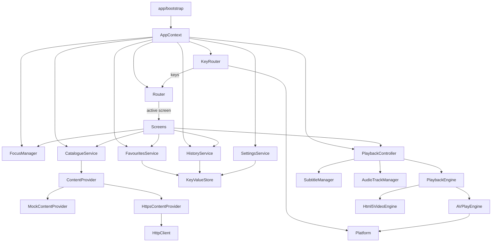
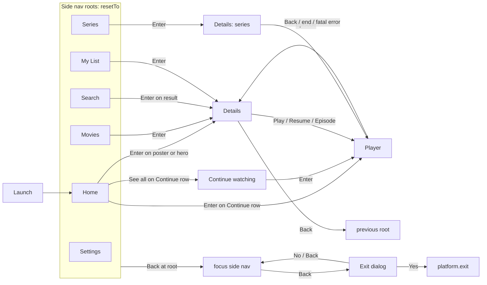

# Samsung TV Streaming App: Architecture and Implementation Plan

Stage 1 deliverable, revised after the Stage 1.5 device probe and Stage 2. Status: **architecture approved; probe findings incorporated (revision 2); Stage 2 foundation implemented (revision 3, 2026-11-22)**. See `docs/DEVELOPMENT.md` for the as-built structure and commands, and `docs/TEST-REPORT.md` for verification.

Project name: **ScreenShelf**. Target: Samsung UE50MU6100 (2017), Tizen 3.0, TV profile, ARMv7, 3840x2160 panel, 1920x1080 logical UI.

Evidence for every [V] row below: `docs/PROBE-REPORT.md` and the raw probe output in `probe/results/latest*.json`.

---

## 0. Ground truth

Tags:
- **[V]** verified on the device or the SDK.
- **[M]** measured on the device. The number is valid for the probe's conditions only.
- **[A]** still assumed, not yet tested.
- **[I]** an inferred explanation, not proven.

| Fact | Status |
|---|---|
| Tizen platform 3.0, profile `tv`, vendor Samsung, `can_launch: tv-samsung` | [V] `sdb capability` |
| CPU armv7 | [V] |
| Panel 3840x2160 | [V] TV REST API |
| SDK has `platforms/tizen-3.0/tv-samsung` | [V] |
| Web engine UA `AppleWebKit/538.1 … Tizen 3.0 TV Safari/538.1` | [V] probe |
| Native syntax: arrow functions, classes, template literals, spread, for…of, generators **work** | [V] probe |
| Native syntax: `let`/`const` outside strict mode, destructuring, default params, async/await, `**`, `?.` **fail** | [V] probe |
| Present: Promise (all, race, correct microtask order), Map/Set/WeakMap, Symbol, `URL`, `Object.assign`, `Array.prototype.find`/`includes`/`from`, `String.prototype.startsWith`/`includes`/`repeat`, `CustomEvent`, `classList`, `dataset`, `closest`/`matches`, `MutationObserver`, `Intl.NumberFormat`, `performance.memory`, localStorage (≥ 8 MB) | [V] probe |
| **Missing**: `Promise.prototype.finally`, `Object.values`/`entries`, `String.prototype.padStart`, `URLSearchParams`, `AbortController`, `IntersectionObserver`, `ResizeObserver` | [V] probe |
| XHR works for packaged files and remote HTTPS. `fetch` exists but **fails for packaged files**. | [V] probe |
| `fetch` to remote HTTPS | **[A] untested**. Not relied upon. |
| CSS present: flexbox (pixel-exact), transforms (unprefixed), transitions + `transitionend`, `calc()`, vw/vh, `object-fit`, `-webkit-line-clamp`, `text-overflow`, `filter`, `will-change`, gradients | [V] probe |
| CSS **missing**: Grid, flexbox `gap`, custom properties, `position: sticky` | [V] probe |
| App viewport exactly **1920x1080**, `devicePixelRatio` 1 | [V] probe |
| One system font for all generic families. SamsungOne availability unknown; rendering not visually checked. | [V] / [A] |
| AVPlay 1.0 present. MP4 H.264/AAC, HLS TS, HLS fMP4 and MPEG-DASH H.264 all play, pause and seek. DASH selected a 3840x2160 H.264 rendition. | [V] probe |
| HEVC, VP9, AC3/E-AC3, MKV, Smooth Streaming | [A] untested |
| HLS WebVTT subtitles arrive via `onsubtitlechange` within about 15 ms of cue time, **with raw HTML tags** | [V] probe |
| `setExternalSubtitlePath` (packaged file) → `PLAYER_ERROR_INVALID_PARAMETER`; DASH exposes no text track | [V] probe |
| `setSpeed` FF/REW inconsistent across streams; `stop()` can throw after a failed `setSpeed` | [V] probe |
| A missing manifest produces **no error callback**; `prepareAsync` never returns | [V] probe |
| `tizen.tvinputdevice` registers all 28 requested keys; 46 supported keys reported | [V] probe |
| Key repeat: first repeat after 458 ms, then every 108 ms; `event.repeat` is always `false` | [M] probe |
| The physical Smart Remote has **no media keys**; Back = 10009 | [V] user + probe |
| TLS: all tested public roots trusted (ISRG X1/X2, GlobalSign, DigiCert G2/G3, Amazon, Starfield, USERTrust); invalid certificates rejected | [V] probe |
| Free system memory about 220 of 1295 MB with the probe running | [M] one measurement |
| Packages signed with the Samsung profile fail with `install failed[118]` (SHA-512 and SHA-256); packages signed with a Tizen developer certificate install | [V] probe |
| Cause of 118: the 2017 firmware doesn't trust Samsung's June 2025 developer intermediate CAs | **[I] inference**, not confirmed by Samsung |
| Remote inspector (`sdb shell 0 debug`) refused (`closed`) for the Tizen-signed app | [V] probe |
| `webapis.avplay` is present in a packaged app **without** loading `$WEBAPIS/webapis/webapis.js` | [V] Stage 2 dev log |
| `<tizen:content-security-policy>` plus a single `<access>` origin installs and allows XHR POST to that origin | [V] Stage 2 |

---

## 1. Architecture overview

### 1.1 Layering

```
┌─────────────────────────────────────────────────────────────┐
│ Screens     Home · Movies · Series · Search · Details ·     │
│             Player · MyList · ContinueWatching · Settings   │
├─────────────────────────────────────────────────────────────┤
│ Components  Carousel · PosterCard · Hero · SideNav ·        │
│             Keyboard · Dialog · Spinner · Toast · TrackMenu │
├──────────────────────┬──────────────────────────────────────┤
│ Navigation           │ Player                               │
│  Router (screen      │  PlaybackController                  │
│  stack) · KeyRouter  │  PlaybackEngine ◄─ AVPlayEngine      │
│  · FocusManager      │                 ◄─ Html5VideoEngine  │
│                      │  SubtitleManager · AudioTrackManager │
├──────────────────────┴──────────────────────────────────────┤
│ Services   CatalogueService · SearchService ·               │
│            FavouritesService · HistoryService · Settings    │
├─────────────────────────────────────────────────────────────┤
│ API        ContentProvider ◄─ MockContentProvider           │
│                            ◄─ HttpsContentProvider (later)  │
│            HttpClient (HTTPS-only, timeout, retry)          │
├─────────────────────────────────────────────────────────────┤
│ Storage    KeyValueStore (localStorage, versioned, safe)    │
├─────────────────────────────────────────────────────────────┤
│ Platform   TizenPlatform (keys, exit, visibility, info)     │
│            ◄─ BrowserPlatform (dev only)                    │
└─────────────────────────────────────────────────────────────┘
```

Rules:
- Dependencies point downward only. Screens never touch `webapis`, `tizen` or `localStorage` directly.
- `Platform` is the only code that touches `tizen.*` and `webapis.*` outside the player engine. This is what makes browser development and unit tests possible.
- No global mutable state except a single `AppContext` object built in `app/bootstrap.ts` and passed down. This is manual dependency injection, with no DI library.

### 1.2 Component diagram



---

## 2. Module specifications

TypeScript signatures are design contracts. They become `src/models` and the interface files in Stage 2.

### A. Application shell (`app/`)
- **Responsibility:**
  - Bootstrap: platform detection, register keys, build `AppContext`.
  - Mount the root DOM: `#side-nav`, `#screen-host`, `#overlay-host`, `#video-plane`.
  - Global error boundary (`window.onerror`).
  - Exit dialog.
  - App lifecycle: `visibilitychange`, plus network online/offline.
- **Startup target:** Home skeleton painted in under 1.5 s after launch; mock data shown in under 2 s. [A] target, to be measured on the TV.

```ts
interface AppContext {
  platform: Platform; router: Router; keys: KeyRouter; focus: FocusManager;
  catalogue: CatalogueService; search: SearchService;
  favourites: FavouritesService; history: HistoryService;
  settings: SettingsService; playback: PlaybackController;
  config: AppConfig;
}
```

### B. Home screen (`screens/home/`)
- **Contents:** Hero (featured) plus rows in this order: Continue watching (hidden if empty), Trending, Recently added, Action, Comedy, Drama, Sci-Fi, My favourites (hidden if empty).
- **Row definitions** come from `CatalogueService.getHomeLayout()`, so the provider decides the order and the screen doesn't hardcode categories.
- **Lazy rows:** only rows within ±1 of the viewport render posters. Rows further away render skeleton placeholders.

### C. Navigation manager (`navigation/router.ts`)
- **Screen stack**, with `push(screen, params)`, `replace`, `pop()` and `resetTo(root)`.
- **Top-level tabs:** Home, Movies, Series, Search, My List and Settings are *roots*. Switching tabs uses `resetTo`, so Back from a root never walks through tab history.
- **Back handling:** an overlay (dialog or menu) closes first, then `screen.onBack()` may consume the key, then pop. At a root, Back moves focus to the side nav if it isn't there already; once there, it opens the exit dialog.
- **Screen lifecycle:** `mount(host) → onShow() → onHide() → destroy()`. `destroy()` must release listeners and timers and drop DOM references. This is the leak guard.
- **Retained screens:** Details stays mounted under Player, hidden with `display:none`, so returning is instant and keeps its focus. Every other screen is destroyed on pop.

```ts
interface Screen {
  readonly id: string;
  mount(host: HTMLElement): void;
  onShow(): void;  onHide(): void;
  onKey(e: RemoteKeyEvent): boolean;   // true = consumed
  onBack(): boolean;                   // true = consumed
  destroy(): void;
}
interface Router {
  push(id: ScreenId, params?: object): void;
  pop(): void; resetTo(id: ScreenId): void;
  current(): Screen | null;
}
```

### D. Focus manager (`navigation/focus/`)
This is the hardest module. Rather than geometric spatial navigation, it uses an explicit **zone graph**, which is predictable and doesn't depend on layout measurements.

- A **FocusZone** is either a linear list (horizontal or vertical) or a grid. Each zone has a `memory` index (last focused item) and neighbour links: `up`, `down`, `left`, `right` pointing at other zones.
- Leaving a zone through an edge enters the neighbour zone at its *remembered* index. The exception is a jump between vertical rows, which picks the item nearest by x position. This gives Netflix-like column alignment, computed from cached offsets, not `getBoundingClientRect`, on each keypress.
- **Exactly one focused element at all times.** It carries a CSS class `is-focused`; DOM `focus()` isn't used, which avoids browser scroll jumps.
- If the focused element is removed, for example a row re-rendered, focus falls back to the same zone at `min(index, length-1)`, then to the zone's parent, then to the screen's default zone. **No focus loss.**
- **Key-repeat throttle:** held arrows step at most every 110 ms.
  - The device repeats after 458 ms, then every 108 ms [M], so the throttle passes about one step per repeat.
  - `event.repeat` is always `false` on this engine [V]. A key counts as "held" when a second keydown for the same code arrives before its keyup.
  - While a key is held, transitions and the focus scale animation are disabled (`.is-fast-scrolling`), so the GPU doesn't queue animations.

```ts
interface FocusZone {
  id: string;
  kind: 'row' | 'column' | 'grid';
  columns?: number;                    // grid only
  size(): number;
  element(i: number): HTMLElement | null;
  onFocus?(i: number): void;           // e.g. carousel scrolls, hero updates
  onSelect?(i: number): void;
  neighbours: Partial<Record<'up'|'down'|'left'|'right', string | (() => string | null)>>;
}
interface FocusManager {
  register(zone: FocusZone): void; unregister(id: string): void;
  focus(zoneId: string, index?: number): void;
  move(dir: Direction): boolean;  select(): void;
  current(): { zone: string; index: number } | null;
  saveState(): FocusSnapshot; restoreState(s: FocusSnapshot): void;  // per screen
}
```

### E. Movie catalogue (`services/catalogue.ts`)
- Wraps the `ContentProvider`, with an in-memory LRU cache of 50 entries and a 5-minute TTL for list endpoints.
- Maps provider DTOs to domain models and validates every field, using the validators in `utils/validate.ts`. Bad items are dropped and logged, and never crash a row.

```ts
interface CatalogueService {
  getHomeLayout(): Promise<RowDescriptor[]>;
  getRow(row: RowDescriptor, page: number): Promise<Page<MediaSummary>>;
  getMovie(id: string): Promise<MovieDetail>;
  getSeries(id: string): Promise<SeriesDetail>;
  getEpisodes(seriesId: string, season: number): Promise<Episode[]>;
  getCategories(kind: MediaKind): Promise<Category[]>;
}
```

### F. Search (`screens/search/`, `services/search.ts`)
- **On-screen keyboard:** our own A–Z, 0–9, space, delete and clear grid. It's fully predictable with the remote. The Tizen IME (system keyboard) varies by firmware, so it's not used in v1.
- **Behaviour:** 300 ms debounce, 2 characters minimum, a maximum query length of 64.
- **Superseded requests:** each new query calls `HttpClient` `abort()` on the previous request (XHR abort, since AbortController is missing [V]). A request token also ensures late responses are ignored.
- **Layout:** the keyboard sits on the left and a results grid of 4 columns on the right. Right from the keyboard edge enters the results.

### G. Movie details (`screens/details/`)
- **Layout:** backdrop, title, year, rating, duration, genres and synopsis (clamped to 4 lines).
- **Actions:** Play / Resume (with a progress bar), Restart (only when there's a saved position), Add/Remove My List, Audio & Subtitles info.
- **Series:** a season selector row, then the episode list.
- **"More like this"** row at the bottom.

### H. Video player (`player/`)
See section 4 for the full design.

### I. Subtitle manager (`player/subtitles.ts`)
- **Track sources:**
  - In-stream HLS WebVTT tracks from the engine [V].
  - Sidecar files (SRT/VTT) from the provider, fetched with `HttpClient` and parsed in JavaScript (`player/srt-parser.ts`, `player/vtt-parser.ts`). AVPlay's `setExternalSubtitlePath` is **not used**: it was refused on the device [V].
- **Timing:**
  - In-stream cues are pushed by `onsubtitlechange` [V]; an empty cue text clears the display [V].
  - Sidecar cues are scheduled against `getCurrentTime()` with a 250 ms poll, and re-synced after every seek.
- **DASH:** no text tracks are exposed [V]. Subtitled DASH content must use sidecar files. The provider should prefer HLS for subtitled titles.
- **Safe rendering (mandatory):**
  - Cue text is **never** assigned to `innerHTML`.
  - `subtitle-sanitize.ts` tokenises cue text. Only `<i>`, `<b>` and `<u>` (no attributes) are recognised, and each one is rebuilt as a fresh `document.createElement` node. All other tags are dropped and their text kept.
  - All text is inserted with `textContent` or `createTextNode`. Entities are decoded by a small fixed table, never by the HTML parser.
  - Line breaks become separate block elements.
  - Unit tests cover script tags, event-handler attributes, nested and unclosed tags, entity tricks and over-long cues (capped at 500 characters).
- Persists the preferred language in Settings and applies it automatically on load. The size setting (S/M/L) only changes a CSS class.

### J. Audio track manager (`player/audio-tracks.ts`)
- Lists audio tracks via `getTotalTrackInfo` and switches with `setSelectTrack('AUDIO', index)`. The switch was verified on a 2-track HLS stream [V].
- **Labels come from provider metadata**, matched by language code. AVPlay's `extra_info` is unreliable [V]: HLS VIDEO entries contained garbage numbers and DASH audio reported `channels: 0`. It's used only as a fallback for the language code.
- Remembers the preferred language.

### K. Favourites (`services/favourites.ts`)
- Local-first set of `{id, kind, addedAt}`, with a maximum of 500 entries.
- Interface ready for remote sync later; the conflict rule is newest `addedAt` wins.

### L. Continue watching (`services/history.ts`)
- **Entry:** `{mediaId, episodeId?, positionMs, durationMs, updatedAt}`.
- **Saving:** on pause, stop, error and app hide, and every 15 s during playback.
- **Finished rule:** watched past 95%, or within 60 s of the end, means finished. The entry is removed (or the series advances to the next episode).
- **"Resume" rule:** shown only when the position is over 60 s and under 95%.
- Keeps at most 50 entries, oldest dropped first.

### M. Settings (`screens/settings/`, `services/settings.ts`)
- **Options:** subtitle language (off/auto/list), subtitle size (S/M/L), audio language, autoplay next episode, clear watch history (with confirmation), clear My List (with confirmation).
- **About section:** app version, platform version, resolution and engine name, read from `Platform`, to help support.

### N. Content provider (`api/`)
See section 5.

### O. Local storage (`storage/kv-store.ts`)
- Namespaced keys `stv:v1:<name>`.
- Every value is stored as JSON `{v: schemaVersion, data}`.
- Reads are wrapped in try/catch, run a per-key **validator**, and fall back to defaults if corrupt.
- Writes are wrapped in try/catch, and a full storage quota surfaces as a toast; they never throw into the UI.
- On a schema version change, a migration function runs per key; if none exists, the key resets.
- Never stores tokens, credentials or stream URLs.

```ts
interface KeyValueStore {
  get<T>(key: string, validate: (x: unknown) => x is T, fallback: T): T;
  set<T>(key: string, value: T): boolean;
  remove(key: string): void;
}
```

### P. HttpClient (`api/http-client.ts`)
This is the **only** network layer, built on `XMLHttpRequest`. `fetch` is not used: it fails for packaged files [V] and is untested for remote URLs [A]. Every network concern is centralised here.

```ts
type HttpErrorKind = 'invalid-url' | 'timeout' | 'aborted' | 'network' | 'http' | 'parse';
interface HttpError { kind: HttpErrorKind; status: number; url: string; message: string }
interface HttpRequest {
  url: string;                       // must pass utils/url.ts (https + allowlisted host)
  method?: 'GET' | 'POST';           // v1 needs GET only
  headers?: Record<string, string>;  // allowlisted header names only
  timeoutMs?: number;                // default 10 000, max 30 000
  responseType: 'json' | 'text';
  maxBytes?: number;                 // default 2 MB; larger responses become 'parse' errors
}
interface HttpHandle<T> { promise: Promise<T>; abort(): void }
interface HttpClient {
  request<T>(req: HttpRequest, validate?: (x: unknown) => x is T): HttpHandle<T>;
}
```

- **URL guard first.** A URL that isn't `https:` or isn't on the allowlist rejects with `invalid-url` before any request is sent.
- **Timeout:** uses `xhr.timeout`, plus a backstop `setTimeout`, and fails with `timeout`.
- **Abort:** `handle.abort()` calls `xhr.abort()` and fails with `aborted`. Callers treat `aborted` as silent.
- **Status:** 2xx is success. Anything else fails with `http` and the status code. Redirects are followed by the engine; the final URL is re-checked against the allowlist via `responseURL` when available.
- **Network errors:** `onerror` or status 0 fails with `network`. TLS failures look identical on this engine [V], so the message never claims a specific cause.
- **JSON:** the response is read as text and parsed with `JSON.parse` in a try/catch (`parse` on failure), then passed through the optional schema validator (`parse` on mismatch). `responseType='json'` is not relied upon.
- **Retries:** none inside HttpClient. Retry policy lives in the services and the player, so it can be tested separately.
- **Exactly one settle per request** (guarded flag). Listeners are nulled after settling to avoid leaks.
- Packaged assets are loaded with the same client in `local` mode. That mode allows only relative paths and skips the URL guard.

### Platform (`app/platform/`)

```ts
interface Platform {
  readonly name: 'tizen' | 'browser';
  registerKeys(names: string[]): void;
  exit(): void;
  onVisibility(cb: (visible: boolean) => void): () => void;
  info(): { platformVersion: string; model?: string; width: number; height: number };
}
```

---

## 3. User experience

### 3.1 Screen layout (1920x1080 logical)

```
┌──┬───────────────────────────────────────────────────────────┐
│  │  HERO  backdrop 1920x810, gradient to bg at bottom & left  │
│S │  Title (72px), meta line, 2-line synopsis, [Play] [My List]│
│I │                                                            │
│D │  Continue watching  ▢▢▢▢▢▢  (progress bars)                │
│E │  Trending           ▢▢▢▢▢▢▢                                │
│  │  Recently added     ▢▢▢▢▢▢▢                                │
│N │  …                                                         │
│A │                                                            │
│V │                                                            │
└──┴───────────────────────────────────────────────────────────┘
 96px collapsed rail (icons), 360px when focused (icons + labels)
```

### 3.2 Navigation map



Notes:
- Continue rows go straight to Player, which resumes. Back from Player then lands on that title's Details, which the router inserts underneath. That makes the "automatic return to movie details" requirement hold everywhere.
- Movies and Series screens: a genre filter row at the top, then a poster grid of 6 columns with infinite paging of 30 items per page.
- My List: a grid of favourites, with an empty-state message and a CTA button.

### 3.3 Remote key map

| Key | Tizen name | keyCode | Registration | Evidence |
|---|---|---|---|---|
| Arrows | — | 38/40/37/39 | default | [V] physical remote |
| Enter | — | 13 | default | [V] physical remote |
| Back | `XF86Back` | 10009 | default | [V] physical; `preventDefault` keeps the app open |
| Red / Green / Blue | `ColorF0Red`/`F1Green`/`F3Blue` | 403/404/406 | register | [V] physical |
| Yellow | `ColorF2Yellow` | 405 | register | registered; press untested |
| Pause / Stop / Rewind / FF | `MediaPause`/`MediaStop`/`MediaRewind`/`MediaFastForward` | 19/413/412/417 | register | [V] injected from the PC only |
| Play | `MediaPlay` | 415 | register | injected event **not received**; untested physically |
| Play/Pause | `MediaPlayPause` | 10252 | register | untested |
| 0–9 | `0`–`9` | 48–57 | register (optional search shortcut) | registered |

**Decision:** the user's physical Smart Remote has **no media keys** [V]. Every function must therefore work with **arrows, Enter and Back alone**. Media and colour keys are optional accelerators, handled when present but never required.

Contextual behaviour:
- Media keys outside the Player: on Details, Play/PlayPause starts playback. Elsewhere they're ignored.
- **Player, controls hidden:**
  - **Enter** toggles play/pause and shows the controls.
  - **Left/Right** seek ±10 s. **Holding Left/Right** enters scrub mode with an accelerating step: 10 s, then 30 s, then 60 s after 2 s held. Releasing commits with a single `seekTo`.
  - **Up** shows the controls. **Down** opens the Audio/Subtitle menu.
  - **Back** shows the controls; a second Back exits to Details.
- **Player, controls visible:** focusable buttons in this order: [Back 10 s] [Play/Pause] [Fwd 10 s] [Audio & Subtitles]. The progress bar is focusable and Left/Right scrubs it.
- Optional accelerators: Rewind/FF step through 2x, 4x, 8x, 16x simulated scrub. Play/Pause/PlayPause/Stop do what they say.

---

## 4. Video architecture

### 4.1 Interfaces

```ts
type EngineState = 'idle'|'loading'|'ready'|'playing'|'paused'|'buffering'|'ended'|'error';

interface PlaybackEngine {
  load(src: PlaybackSource, startMs: number): Promise<void>;
  play(): void; pause(): void; stop(): void;
  seekTo(ms: number): Promise<void>;
  position(): number; duration(): number; state(): EngineState;
  audioTracks(): AudioTrack[]; selectAudio(id: string): void;
  textTracks(): TextTrack[];   selectText(id: string | null): void;
  addExternalSubtitle(url: string): boolean;
  setRect(r: Rect): void;      // logical 1920x1080 coords
  suspend(): void; resume(): void;
  on(ev: EngineEvent, cb: (e: any) => void): () => void;
  destroy(): void;
}

interface PlaybackController {        // UI-facing, engine-agnostic
  open(media: PlayableRef, opts: { resume: boolean }): void;
  close(reason: 'user'|'ended'|'error'): void;
  // owns: engine choice, retry policy, history saves, subtitle/audio prefs
}
```

- **AVPlayEngine:** wraps `webapis.avplay`. This is the production engine on the TV [V].
- **Html5VideoEngine:** wraps `<video>`. It's for **browser development only**. Whether `<video>` plays HLS on this TV is still [A], so it's not a TV fallback in v1.

### 4.2 AVPlay specifics (verified on the device unless marked)

- **Loading `webapis`:** requires `<script src="$WEBAPIS/webapis/webapis.js">` in `index.html`. That path is resolved by the TV. In the browser the script 404s and `Platform` reports `browser`.
- **Video layer:** video renders on a **hardware plane behind the web layer**. That means:
  - An `<object type="application/avplayer">` element is sized via `setDisplayRect`.
  - Everything above it must be transparent: body, screen host and the player screen background.
  - The rest of the UI is hidden (`display:none`) while playing, to cut compositing cost.
- **One instance only.** `avplay.close()` is called on every exit path, including errors and app hide. Missing it is the classic way AVPlay apps leak or lock up the decoder.
- **Lifecycle:** `open(url) → setListener → setDisplayRect → prepareAsync → seekTo(start) → play` [V].
- **Prepare timeout (mandatory):** a missing manifest never fires `onerror`, and `prepareAsync` never returns [V].
  - The engine starts a **15 s** watchdog when `prepareAsync` begins. On expiry it calls `close()` and reports `{kind: 'timeout'}` to the controller.
  - Observed prepare times were 0.6–5.4 s [M], so 15 s leaves margin. The value is configurable.
- **Defensive teardown:** `stop()` threw `PLAYER_ERROR_INVALID_OPERATION` after a failed `setSpeed` [V]. Teardown is therefore `try { stop() } catch {}` followed by `try { close() } catch {}`, and never lets an exception escape.
- **Seeks:** `seekTo` is asynchronous and serialised; 130–900 ms observed [M]. While one seek is pending, new seek requests replace the queued one instead of stacking up.
- **No `setSpeed` in v1.** It was rejected on several HLS streams [V], so trick play is always simulated (section 4.4).
- **App hidden** (Home key or a source change): `suspend()`, and save history. When the app returns: `restore()`. If restore fails, which is [A] untested, the fallback is `close` plus reopen at the saved position.

### 4.3 Format evaluation

| Format | Probe result | Plan | Status |
|---|---|---|---|
| HLS TS segments, H.264/AAC (Apple, Mux) | Play, pause, seek, ABR, in-stream WebVTT subtitles | **Primary** format | [V] |
| HLS fMP4 (Apple advanced) | Play, pause, seek, subtitles | Supported | [V] |
| MP4 progressive H.264/AAC (Blender, W3C) | Play, pause, seek | Secondary; test assets | [V] |
| MPEG-DASH H.264 (Akamai, DASH-IF) | Play, pause, seek, up to 3840x2160; **no subtitle tracks** | Supported for non-subtitled content or with sidecar subtitles | [V] |
| HEVC, VP9, AC3/E-AC3, MKV, Smooth Streaming | Not tested | Don't use until tested | [A] |
| DRM (PlayReady/Widevine) | Out of scope | Not implemented | — |

**Authorised test streams:** Apple's public HLS examples (bipbop / advanced example streams), the DASH-IF test vectors, and Blender Foundation open movies (Big Buck Bunny, Sintel, Tears of Steel, all CC-BY). Exact URLs go in `src/api/mock/streams.ts` with a licence note each. These hosts were all reachable over HTTPS from the TV [V]: `devstreaming-cdn.apple.com`, `test-streams.mux.dev`, `dash.akamaized.net`, `download.blender.org` and `media.w3.org`.

### 4.4 Behaviours

- **Buffering:**
  - `onbufferingstart` shows a spinner after a 300 ms delay, so short stalls don't flicker. `onbufferingprogress` shows a percentage. `onbufferingcomplete` hides the spinner.
  - A **watchdog** treats buffering for more than 20 s as a soft error.
- **Error recovery:** on network error or buffering timeout, retry up to 3 times with 2 s, 5 s and 10 s backoff, reopening at the last good position. After that, a fatal error dialog offers [Retry] and [Back to details]. Errors are classified as network, unsupported format or unknown, and the message says which.
- **Error classes** (from the controller):
  - `timeout`: the prepare watchdog fired.
  - `network`: `onerror` with a network or connection type, or a buffering watchdog timeout.
  - `unsupported`: a format or codec error.
  - `unknown`.
  The retry policy above applies to `timeout` and `network` only.
- **Rewind/FF:** `setSpeed` is inconsistent on this device [V], so trick play is **always simulated**. A position indicator jumps ±(10 s × speed) per 500 ms tick, then a single `seekTo` happens on Enter or key release. The trigger is a held Left/Right, and optionally the Rewind/FF keys (section 3.3).
- **End of playback:** `onstreamcompleted` clears the history entry, then either autoplays the next episode (series, if the setting is on, with a 10 s countdown) or returns to Details.
- **Subtitles:** see module I.
  - In-stream HLS WebVTT is delivered through `onsubtitlechange` [V].
  - Sidecar SRT/VTT is parsed in JavaScript. `setExternalSubtitlePath` was refused [V].
  - Every cue goes through the subtitle sanitiser.

---

## 5. Content architecture

### 5.1 Domain models (`src/models/`)

```ts
type MediaKind = 'movie' | 'series';
interface ImageRef { url: string; width: number; height: number }   // provider gives sized URLs
interface Artwork { poster: ImageRef; backdrop: ImageRef; logo?: ImageRef }
interface MediaSummary { id: string; kind: MediaKind; title: string; year?: number;
  rating?: string; artwork: Artwork; progress?: number /*0..1*/ }
interface MovieDetail extends MediaSummary { kind: 'movie'; synopsis: string;
  durationMs: number; genres: string[]; cast: string[]; directors: string[];
  audioLanguages: string[]; subtitleLanguages: string[] }
interface SeriesDetail extends MediaSummary { kind: 'series'; synopsis: string;
  genres: string[]; seasons: { number: number; episodeCount: number }[] }
interface Episode { id: string; seriesId: string; season: number; number: number;
  title: string; synopsis: string; durationMs: number; still?: ImageRef }
interface Category { id: string; name: string; kind: MediaKind }
interface RowDescriptor { id: string; title: string;
  source: { type: 'category'|'trending'|'recent'|'continue'|'favourites'; ref?: string } }
interface Page<T> { items: T[]; page: number; totalPages: number }
interface PlayableRef { mediaId: string; episodeId?: string }
interface PlaybackSource { url: string; type: 'hls'|'dash'|'mp4';
  subtitles: SubtitleRef[]; expiresAt?: number }
interface SubtitleRef { lang: string; label: string; url: string; format: 'srt'|'vtt'|'ttml' }
interface WatchEntry { mediaId: string; episodeId?: string; positionMs: number;
  durationMs: number; updatedAt: number }
interface FavouriteEntry { id: string; kind: MediaKind; addedAt: number }
```

### 5.2 ContentProvider

```ts
interface ContentProvider {
  listMovies(q: { category?: string; page: number; pageSize: number }): Promise<Page<MediaSummary>>;
  listSeries(q: { category?: string; page: number; pageSize: number }): Promise<Page<MediaSummary>>;
  getMovie(id: string): Promise<MovieDetail>;
  getSeries(id: string): Promise<SeriesDetail>;
  getEpisodes(seriesId: string, season: number): Promise<Episode[]>;
  getCategories(kind: MediaKind): Promise<Category[]>;
  getHomeLayout(): Promise<RowDescriptor[]>;
  getRow(id: string, page: number): Promise<Page<MediaSummary>>;
  search(q: { text: string; page: number }): Promise<Page<MediaSummary>>;
  getPlaybackSource(ref: PlayableRef): Promise<PlaybackSource>;   // resolved at play time
  // user data: local in v1; remote-capable interface
  getContinueWatching(): Promise<WatchEntry[]>;
  getFavourites(): Promise<FavouriteEntry[]>;
}
```

Endpoint mapping for `HttpsContentProvider`, built later:

| Method | Endpoint |
|---|---|
| listMovies / getRow(category) | `GET /api/v1/movies?category=&page=&pageSize=` |
| getMovie | `GET /api/v1/movies/{id}` |
| getCategories | `GET /api/v1/categories?kind=` |
| search | `GET /api/v1/search?q=&page=` |
| getContinueWatching | `GET /api/v1/continue-watching` |
| getFavourites | `GET /api/v1/favourites` |
| *missing from the spec*: series, episodes, home layout, playback source | proposed: `/api/v1/series`, `/api/v1/series/{id}/seasons/{n}`, `/api/v1/home`, `/api/v1/playback/{id}` |

**Weakness found:** the endpoint list in the spec has no series endpoints and no playback-source endpoint. Playback URLs must not be embedded in catalogue responses, because they may be short-lived or signed. The four proposed endpoints above fill the gap; confirm them with whoever builds the backend.

### 5.3 Mock provider

- In-memory catalogue of about 60 movies and 8 series, with deterministic IDs.
- Artwork is **generated locally**: CSS gradient plus title text, or inline SVG. So there are no network images and no copyrighted art.
- Configurable latency (default 150 ms) and an error-injection flag, used for network-failure tests.
- Playback sources point at the authorised test streams in section 4.3.

---

## 6. UI design specification

### 6.1 Tokens

CSS custom properties are unsupported on the device [V], so tokens are **TypeScript constants**. `scripts/tokens.mjs` generates `tokens.css` at build time, so the values are defined once.

| Token | Value |
|---|---|
| bg | `#101116` (Stage 2 approved value) |
| surface | `#191B24` |
| text / muted | `#FFFFFF` / `#A5A7B2` |
| accent | `#4F8CFF`, our own blue. Netflix red is deliberately avoided. |
| status ok / error | `#4FD18B` / `#FF6B6B` (shell status only) |
| focus | 6px solid white outline + static blue glow pseudo-element, scale 1.08 |
| radius | 8px cards, pill buttons |
| font | `sans-serif`, the system font. The device maps every generic family to one font [V]; whether that's SamsungOne is unknown. No web font download, which keeps startup fast and avoids licensing. Visual legibility gets checked on the TV in Stage 2/3. |
| type scale (px @1080p) | hero 72 / row title 34 / body 26 / meta 22 / caption 20. Minimum 20 for legibility at 3 m. |
| safe area | 96px left rail; 64px right; 54px top and bottom (5% overscan margin) |
| poster | 240x360 (2:3), 7 visible per row, 24px spacing (margins, no flex `gap`) |
| landscape card | 400x225 (16:9), for the Continue row |

### 6.2 Motion
- Only `transform` and `opacity` are animated, with 180 ms ease-out.
- Carousel scroll uses `translate3d` on the row track. `scrollLeft` isn't used because it's not GPU-composited on old engines.
- Hero crossfade on focus change is delayed 400 ms, so fast scrolling doesn't trigger image loads.
- No blur, `box-shadow` animation or `filter` on moving elements, since all of these are expensive on this GPU.

### 6.3 4K scaling
- The web app renders at exactly **1920x1080 with `devicePixelRatio` 1** [V], and the TV scales the composited UI to the 3840x2160 panel.
- All CSS is authored in fixed 1080p pixels. **The viewport-scaling fallback is dropped**, since no scaling code is needed on the target. `app/viewport.ts` only logs a warning in dev builds if the viewport is ever not 1920x1080.
- Images are requested at 1080p sizes, not 4K, which saves memory. The **video plane** is independent and decodes at native resolution, so 4K streams stay sharp.

### 6.4 Visual identity
This is Netflix-*inspired* (dark, cinematic, horizontal rows), but without copying Netflix's red, logo, "N" mark or exact layout metrics. We use our own name, accent colour and icons. This avoids trade-dress problems if the app is ever published.

---

## 7. Project structure

```
123movies/                   (folder name ≠ app name; app name TBD, see R10)
├─ docs/          ARCHITECTURE.md, TEST-REPORT.md, INSTALL.md
├─ tizen/         config.xml, icon.png          → copied into dist/
├─ src/
│  ├─ app/        bootstrap.ts, context.ts, viewport.ts, lifecycle.ts
│  │  └─ platform/  platform.ts, tizen.ts, browser.ts, keys.ts
│  ├─ components/ carousel/, poster-card/, hero/, side-nav/, keyboard/,
│  │              dialog/, spinner/, toast/, track-menu/, progress-bar/
│  ├─ screens/    home/, movies/, series/, search/, details/, player/,
│  │              my-list/, continue/, settings/, exit-dialog/
│  ├─ navigation/ router.ts, key-router.ts, focus/ (manager.ts, zone.ts)
│  ├─ player/     controller.ts, engine.ts, avplay-engine.ts, html5-engine.ts,
│  │              subtitles.ts, subtitle-sanitize.ts, srt-parser.ts, vtt-parser.ts,
│  │              audio-tracks.ts
│  ├─ dev/        log-sink.ts (dev builds only; removed from release by build flag)
│  ├─ services/   catalogue.ts, search.ts, favourites.ts, history.ts, settings.ts
│  ├─ api/        content-provider.ts, http-client.ts, https-provider.ts (stub)
│  │  └─ mock/    mock-provider.ts, catalogue.data.ts, streams.ts
│  ├─ models/     media.ts, playback.ts, user.ts
│  ├─ storage/    kv-store.ts, schemas.ts
│  ├─ utils/      dom.ts (h() helper), validate.ts, url.ts, debounce.ts, lru.ts, log.ts
│  ├─ styles/     tokens.ts, base.css, components/*.css, screens/*.css
│  ├─ types/      tizen.d.ts, webapis.d.ts, compat.d.ts (hand-written, minimal)
│  └─ index.html
├─ tests/
│  ├─ unit/        focus, router, kv-store, validators, url, srt-parser, history rules
│  ├─ integration/ mock provider ↔ services, screen flows on fake DOM
│  ├─ fakes/       fake-dom.ts, fake-engine.ts, fake-platform.ts
│  └─ device/      probe app + on-TV checklist
├─ scripts/       build.mjs, es5-check.mjs, css-check.mjs, tokens.mjs, tv.mjs,
│                 dev-sink.mjs (PC-side receiver for the dev log sink)
├─ probe/         Stage 1.5 device probe (kept for re-running compatibility checks)
├─ dist/          build output (git-ignored) → packaged .wgt
└─ package.json, tsconfig.json, tsconfig.test.json, .gitignore
```

### 7.1 Build pipeline (critical evaluation)

**esbuild alone is not enough.** esbuild cannot lower ES2015 syntax such as classes, `let`/`const` scoping and destructuring to ES5; it errors instead. TypeScript can. So the pipeline is:

1. `tsc` with `target: ES5`, `module: ES2015`, and `lib: ["ES5", "ES2015.Promise", "ES2015.Collection", "DOM"]`.
   - **Why ES5 stays the target:** the engine parses some ES2015 (arrows, classes, template literals) but rejects destructuring, default parameters, async/await and sloppy-mode `let`/`const` [V]. One simple rule (all ES5) beats tracking a partial feature list.
   - The `lib` setting is a **type-level guard**: TypeScript itself rejects APIs that aren't present. The **confirmed-missing** list is `Promise.prototype.finally`, `Object.values`/`entries`, `String.prototype.padStart`, `URLSearchParams`, `AbortController`, `IntersectionObserver` and `ResizeObserver` [V]. These must stay unavailable at type level.
   - APIs that are present but outside the ES5 lib (`Object.assign`, `Array.prototype.find`/`includes`, `String.prototype.startsWith`) are declared individually in `types/compat.d.ts`, each with a comment citing the probe result.
   - The DOM lib includes `fetch`; a lint grep bans it in `src/` (see HttpClient).
   - `downlevelIteration: false`, plus a rule that there's no `for…of` over Map or Set; use `forEach`.
   - `importHelpers: false`. tsc inlines its small helpers.
2. `esbuild` bundles tsc's ES5 output into **one IIFE** (`format: iife`, `target: es5`, minify). esbuild doesn't need to lower anything because the input is already ES5; it only bundles and minifies.
3. **`es5-check`**: parse `dist/app.js` with `acorn` (`ecmaVersion: 5`). The build **fails** on any ES2015+ syntax that slipped through, including anything esbuild's own wrapper emits. This is the safety net for the whole constraint.
4. CSS: plain CSS files concatenated with a tiny Node script, no PostCSS. `css-check` rejects `display:grid`, `var(--`, `position:sticky` and `gap` in flex containers.
5. Copy `tizen/config.xml`, the icon and `index.html` into `dist/`. Then `tizen build-web` and `tizen package -t wgt -s <profile>`.

Alternative considered: tsc `outFile` with `module: none` (namespaces) and no bundler. This has zero extra dependencies, but namespaces are awkward, can't be tree-shaken and complicate tests. **Rejected.**

**Tests:** Node 24 runs `.ts` directly through type stripping. The code uses no enums, no namespaces and no parameter properties (`erasableSyntaxOnly`), which keeps it strippable. Tests run with `node --test`, with **no test framework dependency**. DOM-dependent tests use a small fake DOM covering only the subset the app uses. Adding jsdom would bring a large dependency tree, so it's rejected unless the fake DOM proves insufficient.

### 7.2 Dependencies

| Package | Kind | Why |
|---|---|---|
| typescript | dev | ES5 lowering + API guard. **Pinned at 5.9.3**: TypeScript 6.0 deprecates and 7.0 removes `target: ES5`. |
| esbuild | dev | bundling + minify |
| acorn | dev | ES5 output gate (zero deps) |
| — | runtime | **none**. No framework, no polyfill library. |

---

## 8. Security design

| Control | Implementation |
|---|---|
| HTTPS only | `HttpClient` rejects any non-`https:` URL before the request. `config.xml` `<access origin>` lists only the configured API host(s) and test-stream hosts, with no `*`. |
| CSP | `<tizen:content-security-policy>`: `default-src 'self'; script-src 'self'; style-src 'self'; img-src 'self' https: data:; media-src https:; connect-src https://<api-host>`. No `unsafe-eval`, no inline script. |
| No remote JS | A single bundled script. No `eval`, `new Function`, string `setTimeout`, JSONP or dynamic `<script>`. Enforced by a build grep. |
| DOM injection | Text is set with `textContent` only. `h()` has no innerHTML path. Provider strings are never interpreted as HTML. A build grep bans `innerHTML`, `outerHTML`, `insertAdjacentHTML` and `document.write` in `src/`. |
| Subtitles | Cue text from AVPlay contains raw HTML tags [V] and is treated as **untrusted**. It's rendered only through `subtitle-sanitize.ts`: an `<i>`/`<b>`/`<u>` whitelist, elements rebuilt with `createElement`, text added via `textContent`, a 500-character cap, and fixed-table entity decoding. Same path for sidecar SRT/VTT. |
| Network layer | All requests go through `HttpClient` (XHR), which centralises the URL guard, timeout, abort, status, network-error and JSON-parse handling. `fetch` is banned in `src/` by a build grep. |
| URL validation | `utils/url.ts`: parse, require `https:`, check the host against the allowlist from config, and reject credentials in the URL (`user:pass@`). Applied to image, stream and subtitle URLs. |
| Input validation | Search text: trimmed, max 64 characters, control characters stripped, URL-encoded. IDs: `/^[A-Za-z0-9_-]{1,64}$/`. Every provider response passes through schema validators. |
| Credentials | None in v1. Later, tokens are kept in memory only, obtained via a device-login flow. Nothing secret goes in the bundle or `config.xml`. The API base URL is config, not a secret. |
| Privileges | `http://tizen.org/privilege/internet` and `http://tizen.org/privilege/tv.inputdevice` only. AVPlay worked without any extra privilege [V]. `webapis.productinfo` (firmware and model) needs a privilege we don't request, so the About screen shows the platform version only. |
| Storage | Only non-sensitive data: favourites, history, settings. Validated on read. |
| Errors | User-facing messages are generic. Detail goes to the `log` utility, which keeps a 200-entry ring buffer viewable in Settings → About, with no remote telemetry in v1. |
| DRM | Not implemented, not bypassed. |
| Navigation | `<tizen:allow-navigation>` is empty, so the app can't be navigated to external pages. |
| Signing material | Certificate profiles and private keys stay outside the repo: `C:\Development\Tizen\sdk-data` (Tizen dev profile `probe-tizen`) and `C:\Users\imran\SamsungCertificate` (Samsung profile, kept for release investigation). `.gitignore` blocks `*.p12`, `*.pem`, `*.pri` and `*.pwd`. |
| Dev log sink | Dev builds only. It POSTs logs to the developer PC over plain HTTP on the LAN; the PC's address is set at build time and is never a remote host. It's removed from release builds by a build flag, and a release-build check fails if `dev/` code or the sink address appears in the bundle. |

---

## 9. Performance plan (2017 ARMv7, limited RAM shared with the system)

- **DOM budget:** fewer than 1,500 live nodes on Home.
  - Each row renders at most 7 visible posters plus a 3-poster buffer each side. That's 13 nodes recycled from a pool; the carousel *rebinds* data instead of creating nodes.
  - Rows outside ±1 of the viewport are skeleton rectangles only.
- **Images:**
  - Sized URLs (240x360 posters, 1280x720 backdrop at most).
  - At most 4 concurrent loads (queue), cancelled by clearing `src` when a row scrolls out of the buffer.
  - A single reused `` for the hero backdrop.
- **Animation:** transform/opacity only. Transitions are disabled while a key is held. `will-change: transform` only on the row track currently focused.
- **JavaScript:**
  - Single bundle under 150 KB minified [A] (parse time to be measured).
  - No layout reads during key handling; offsets are cached on render.
  - One global keydown listener.
- **Memory:**
  - Every screen and component has `destroy()`. In debug builds the router asserts that the listener and timer count returns to baseline.
  - LRU caches are bounded.
  - AVPlay is always `close()`d.
  - **Measured warning, not a limit:** the probe saw about **220 MB free of 1295 MB** system memory, with a 10 MB JS heap [M]. This is one measurement under probe conditions. It isn't an app memory budget, but it shows there's little headroom.
  - Dev builds report `performance.memory.usedJSHeapSize` [V] through the dev log sink, and Stage 3/6 soak tests track the trend. Pooling, image caps and the single AVPlay instance stay mandatory.
- **Measured baseline [M]:** first frame 136 ms after the first script; DOMContentLoaded 249 ms; local poster load 25 ms; 20 parallel poster loads 71 ms. Carousel focus simulation (121 nodes): avg 24 ms per frame (41 fps), p95 33 ms. The scale-on-focus animation is disabled during held keys, and frame times are re-measured on the real UI in Stage 3.
- **Startup:**
  - Inline skeleton markup in `index.html`, so the Home skeleton renders before data arrives.
  - Data fetch is deferred one frame after first paint.

---

## 10. Testing strategy

| Layer | What | How | Where |
|---|---|---|---|
| Unit | Focus zone graph (edges, memory, fallback after removal, key-repeat throttle), router stack and Back rules, KV store (corrupt data, quota, migration), validators, URL guard, SRT parser, history rules (95% / 60 s), debounce, LRU | `node --test` | PC |
| Navigation / focus | Scripted key sequences, e.g. "Down×3, Right×5, Back" leading to the expected focus | Fake DOM + KeyRouter | PC |
| Content provider | Contract test suite run against `MockContentProvider` (later also the HTTPS provider against a local fixture server); error injection, malformed DTOs | `node --test` | PC |
| Player | `PlaybackController` against a **FakeEngine**: retry/backoff, buffering watchdog, scrub simulation, history saves, end → Details | `node --test` | PC |
| Build gates | ES5 syntax check, banned CSS, banned API grep (eval, innerHTML), bundle size budget | `npm run check` | PC |
| Subtitle sanitiser | Script tags, event-handler attributes, nested and unclosed tags, entities, over-long cues; output never contains elements outside the whitelist | `node --test` with the fake DOM | PC |
| HttpClient | Timeout, abort, non-2xx, status 0, invalid JSON, schema mismatch, invalid or non-allowlisted URL, single settle | `node --test` with a fake XHR | PC |
| Device compatibility | **Done in Stage 1.5** (`docs/PROBE-REPORT.md`). Re-run `probe/` after any firmware update. | Probe app + PC collector | **TV** |
| Real TV E2E | Checklist from spec section 10: launch, navigation, focus, search, details, player launch, controls, subtitles, Back, network failure (Wi-Fi off), restart persistence. Each run is logged in `docs/TEST-REPORT.md` with date, build hash and pass/fail. | Physical remote (no media keys), plus scripted keys via the TV's WebSocket remote API for repeatable sequences, labelled "[PC→TV] injected" | **TV** |
| Leak/soak | 30 min of carousel navigation plus 5 play/stop cycles; JS heap trend | **Dev log sink** reporting `performance.memory`. The remote inspector isn't available (R15). | **TV** |

- A test is never marked as passing on the TV unless it ran on the TV. Browser runs are labelled "browser".
- Injected keys are labelled separately from physical presses.
- On-device results come back through the dev log sink, since the inspector is unavailable.

---

## 11. Risk register

Status values: **Open**, **Mitigated** (mitigation designed, still tracked), **Resolved**, **Retired**.

| # | Risk | Status | Impact | Evidence / mitigation |
|---|---|---|---|---|
| R1 | Old TLS root store rejects modern CAs | **Retired** (2026-11-22) | — | The probe connected over XHR to ISRG X1/X2, GlobalSign, DigiCert G2/G3, Amazon Root CA 1, Starfield G2 and USERTrust. Expired, self-signed, untrusted-root and wrong-host certificates were rejected. AVPlay loaded content from Let's Encrypt, GlobalSign, DigiCert G3 and Starfield hosts. Source: PROBE-REPORT §8. |
| R2 | Web engine features differ from assumptions | **Resolved** (2026-11-22) | — | The full feature matrix was measured (PROBE-REPORT §4–5) and folded into §0, §7.1 and §6. The lib guard lists the confirmed-missing APIs; the ES5 target is retained. |
| R3 | AVPlay quirks on 2017 firmware | **Mitigated**, still open | High for player UX | **Confirmed quirks:** `setSpeed` inconsistent; `stop()` can throw; no error and a hung prepare on a missing manifest; external subtitle path refused; DASH has no text tracks; unreliable `extra_info`; raw HTML in cue text. **Mitigations:** simulated scrub, defensive teardown, 15 s prepare watchdog, JS sidecar subtitles, HLS preferred for subtitled titles, provider-supplied track labels, subtitle sanitiser. **Still untested:** suspend/restore on Home, HEVC/VP9/AC3. |
| R4 | Developer Mode IP entry unreliable on this TV | Mitigated | Medium: blocks installs | Key-entry workaround documented. Re-check `developerIP` through the TV REST API before installs. |
| R5 | Certificate expiry or DUID mismatch breaks installs | Open | Medium | The `probe-tizen` dev certificate and the Samsung certificate are both kept outside the repo. Expiry dates are tracked (Samsung: 2027-11-22). |
| R6 | Custom focus engine complexity: the biggest code risk | Medium | Explicit zone graph, heavy unit tests, no geometry dependence |
| R7 | DOM/GPU performance on ARMv7: stutter with 9 rows | Medium | Node pooling, virtualisation, transform-only, held-key no-animation mode |
| R8 | No framework means a hand-rolled view layer may grow ad hoc | Medium (maintainability) | Strict component contract (`mount`/`update`/`destroy`), one `h()` helper, review per stage |
| R9 | Spec's API endpoints lack series, playback and home | Low now, high later | Proposed endpoints in section 5.2 |
| R10 | Naming: "123movies" is widely associated with a piracy site | Medium (store rejection, reputation) | Choose a neutral app name and package ID before Stage 6 (the ID is baked into the installed package) |
| R11 | Spec lists Continue watching as both a home row and a screen | Low | Screen = "See all" from the row (navigation map) |
| R12 | `localStorage` may be wiped on reinstall during development | Low | Expected; noted in the test report |
| R13 | Remote key codes differ from the docs | **Resolved** | — | Physical arrows, Enter, Back and Red/Green/Blue match the docs. The physical remote has no media keys, so the design no longer depends on them (D6). |
| R14 | **The TV rejects current Samsung-signed packages** (`install failed[118]`) | **Open**, release risk | High for any Samsung Store or Samsung-signed release; none for development | **Measured:** Samsung profile (Author CA and VD DEVELOPER Public CA Class, both issued June 2025) gives 118 with SHA-512 and with SHA-256 signatures. A Tizen developer certificate installs. The clock was on Auto and the firmware reported as latest. **Inferred, not confirmed:** the 2017 firmware doesn't trust the 2025 Samsung intermediates. **Mitigation:** development uses `probe-tizen` (D1). Stage 2: dev and release `.wgt` builds signed with `probe-tizen` installed and launched [V]. Samsung Store signing compatibility is **unresolved**. Before Stage 7, ask Samsung developer support and re-test after any firmware update. |
| R15 | No remote inspector for Tizen-signed apps (`sdb shell 0 debug` returns `closed`) | Mitigated | Medium: slower debugging | Dev-only LAN log sink (D2). **Stage 2:** the production sink (`src/dev/log-sink.ts`) delivered TV startup logs to `scripts/dev-sink.mjs` [V]. The release build sends nothing, and an automated check proves the sink is excluded [V]. Unit tests cover the logic on the PC. |
| R16 | Remote `fetch` untested; `fetch` fails for packaged files | Mitigated | Low | All networking goes through the XHR HttpClient (D4). `fetch` is banned in `src/`. |
| R17 | Low free system memory (about 220 MB measured once) | Open, monitored | Medium | Treated as a warning, not a limit (§9). Heap trend is tracked in soak tests via the dev log sink. |
| R18 | Font legibility not visually checked (one system font) | Open | Low | Visual check on the TV in Stage 2/3. Minimum 20 px text. |

---

## 12. Implementation roadmap and effort

Effort in focused working days, excluding your review time.

| Stage | Scope | Exit criteria | Effort |
|---|---|---|---|
| **1.5 Probe** | Probe app, install, run, collect results | **Done 2026-11-22**: `docs/PROBE-REPORT.md`; this document revision 2 | done |
| 2 Foundation (re-scoped by the Stage 2 brief) | Build pipeline + gates, tokens, `h()`, HttpClient, dev log sink, platform abstraction, technical shell | **Done 2026-11-22**: `npm run check` green; shell installed and launched on the TV (`docs/TEST-REPORT.md`) | done |
| 2b UI | Components and all 9 screens on mock data (deferred from the original Stage 2) | screens render at 1920x1080 | 3–4 d |
| 3 Remote | FocusManager, KeyRouter, Router Back rules, key registration; on-TV navigation pass | Focus tests green; TV navigation checklist passes | 2–3 d |
| 4 Player | PlaybackController, AVPlayEngine, Html5Engine, subtitles, audio, buffering and errors; test streams | FakeEngine tests green; each stream format tried on the TV | 3–4 d |
| 5 Integration | Services wired; favourites, history and settings persistence; network-failure handling | Restart persistence verified on the TV | 1.5–2 d |
| 6 Device testing | Full on-TV checklist, soak/leak test, fixes | TEST-REPORT.md complete | 1.5–2 d |
| 7 Release prep | Signed `.wgt` (Tizen dev-signed; Samsung signing blocked by R14), icon, metadata, INSTALL/BUILD docs | Package installs cleanly by following the docs | 1 d |
| **Total remaining** | | | **about 14–18 days** |

Stage 2 adds two small modules defined by the probe findings: `HttpClient` (P) and `subtitle-sanitize`, plus the dev log sink. These fit inside the existing estimates.

---

## 13. Decision log

Each entry: decision, reason, evidence, status. Dates are 2026-11-22 unless noted.

| ID | Decision | Reason / evidence | Status |
|---|---|---|---|
| D1 | Development builds are signed with the **Tizen developer profile `probe-tizen`**, now the active CLI profile. The Samsung profile `samsung` is kept unchanged for release investigation. | Samsung-signed packages fail with 118; Tizen-signed install (PROBE-REPORT §3) | Approved |
| D2 | **Dev-only LAN log sink** (`src/dev/log-sink.ts` + `scripts/dev-sink.mjs`), stripped from release builds | Remote inspector unavailable (R15); the probe collector proved the approach | Approved |
| D3 | **Keep the ES5 compile target**, with the lib guard excluding the confirmed-missing APIs | Partial ES2015 support only (PROBE-REPORT §4) | Approved |
| D4 | **A single XHR HttpClient** centralises URL guard, timeout, abort, status, network-error and JSON handling. `fetch` is banned; remote `fetch` stays untested. | `fetch` fails for packaged files; no AbortController | Approved |
| D5 | CSS: flexbox + margins, transforms, fixed 1080p pixels. **No grid, `gap`, CSS variables or sticky. Viewport-scaling fallback dropped.** | PROBE-REPORT §5; viewport 1920x1080 at DPR 1 | Approved |
| D6 | **Remote: every function works with arrows, Enter and Back only.** Media and colour keys are optional. Held keys are detected by timing, not `event.repeat`. | The physical remote has no media keys; `event.repeat` is always false | Approved |
| D7 | Player: **15 s prepare watchdog**, defensive `stop`/`close`, **simulated scrub (no `setSpeed`)**, provider-supplied track labels, HLS preferred for subtitled content | PROBE-REPORT §7 | Approved |
| D8 | Subtitles: **JS sidecar SRT/VTT renderer** (no `setExternalSubtitlePath`) and a **mandatory sanitiser** (whitelist `<i>/<b>/<u>`, `textContent` only, never `innerHTML`) | External path refused; raw HTML in cues | Approved |
| D9 | Memory: about 220 MB free is a **measured warning, not an app limit**. Pooling, image caps and the single AVPlay instance are mandatory; heap trend is tracked in soak tests. | One measurement (PROBE-REPORT §9) | Approved |
| D10 | Performance: transform/opacity-only focus animation, scale disabled during held keys, re-measured on the real UI in Stage 3 | 41 fps in the carousel simulation | Approved |
| D11 | Privileges: `internet` + `tv.inputdevice` only. No `productinfo` privilege. | AVPlay works without extra privileges | Approved |
| D12 | Project name **ScreenShelf**; the probe package ID `SSProbe001` is probe-only. The production package ID is chosen before Stage 6. | R10 | Approved (name); package ID open |

### Open questions
1. Production package ID and application ID (needed before Stage 6).
2. Samsung Store path (R14): pursue Samsung developer support now or defer until Stage 7?
3. Accent colour: the default is `#4f8cff` unless changed.
