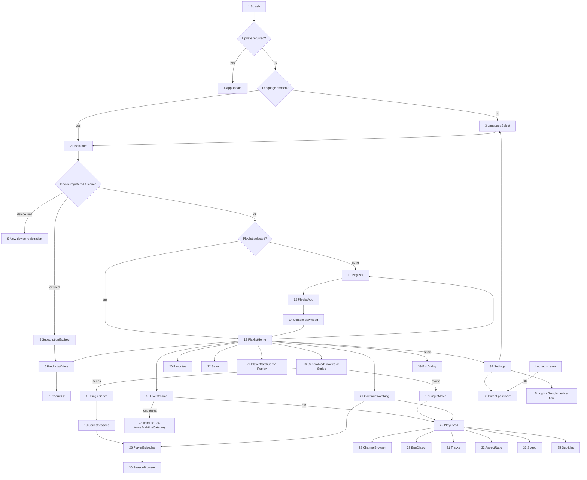
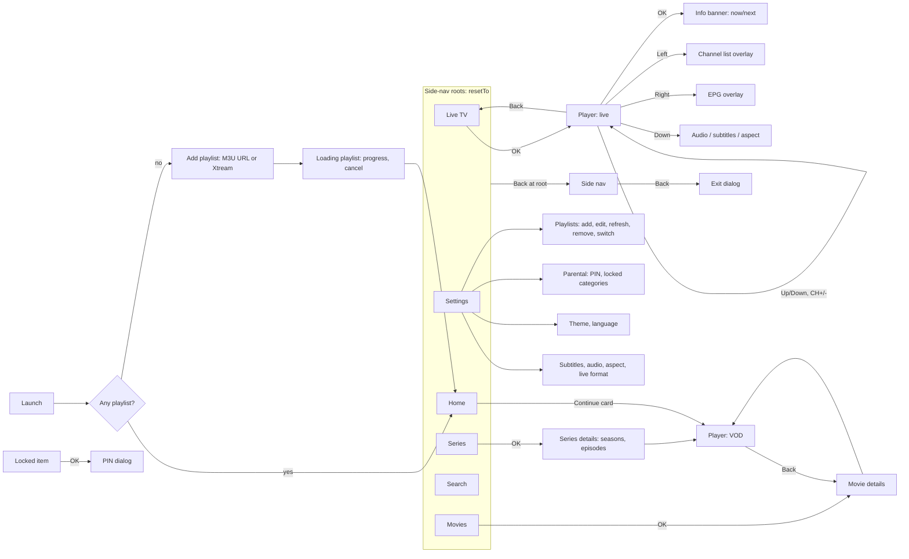

# Navigation Map

Evidence IDs: `APPLICATION-OVERVIEW.md` §3. Screen numbers: `SCREEN-INVENTORY.md`.

Screens are CONFIRMED-STATIC (they exist in the manifest). **Transitions are INFERRED** from class names, string resources and screenshots; no method bodies were read and the app was not run. Confidence per edge is Medium unless noted.

## 1. Reference app (Ibo One)

| Edge / rule | Status | Conf. | Basis |
|---|---|---|---|
| Splash is the only launcher | CONFIRMED-STATIC | High | A3 |
| Update gate before use ("UPDATE REQUIRED") | INFERRED | Medium | A3 strings + AppUpdateActivity |
| Language selection at first run and from Settings | INFERRED | Medium | `LanguageSelectActivity` + `LanguageSelectDialog`; "You can switch languages anytime from the settings menu" (A3) |
| Licence/registration gate (expired, device limit) | INFERRED | Medium | Subscription activities and strings (A3, A5) |
| Login is optional ("Skip Login For Now") | CONFIRMED-STATIC (string) | High | A3 |
| Catalogue download before browsing | INFERRED | Medium | "Still downloading content." + `ContentDownloadService` (A3) |
| Players are `singleInstance` activities (separate task) | CONFIRMED-STATIC | High | A3 |
| Up/Down zaps channels in the player | CONFIRMED-STATIC (hint string) | High | "Press Up and Down to change channel" (A3) |
| Locked streams prompt for parent password | CONFIRMED-STATIC (string) | High | A3 |
| Back at home opens exit dialog | INFERRED | Medium | `ExitDialog` (A3) |

## 2. Proposed ScreenShelf IPTV navigation (for Stage 2 review; not approved)

Adapts the approved ScreenShelf router rules (screen stack; roots use `resetTo`; overlays close first on Back; Back at a root focuses the side nav, then the exit dialog; ARCHITECTURE.md §2C). Every function is reachable with arrows, OK and Back only (decision D6). No vendor backend, no licence gate, no login.

Differences from Ibo One, by design:
- **Long-press is never required.** Ibo One relies on "Long click for options". ScreenShelf gives every list item a visible Options action (e.g. a "⋯" button reached with Right, or the Red key). Long-press (detected by key-repeat timing, first repeat after about 458 ms on the target TV, PROBE-REPORT §6) remains an accelerator.
- Player overlays are mapped to arrow keys instead of separate dialog activities, so the player never loses the video plane.
- No update gate, licence gate, login or device registration.
